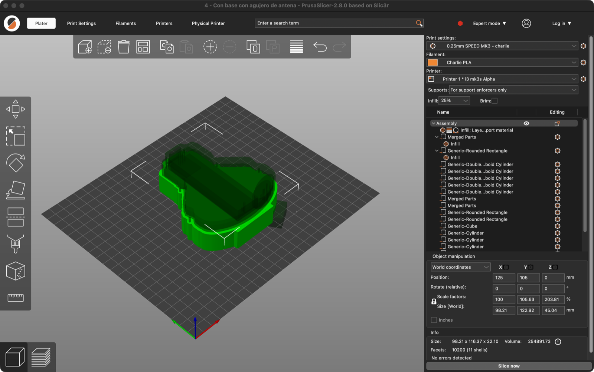
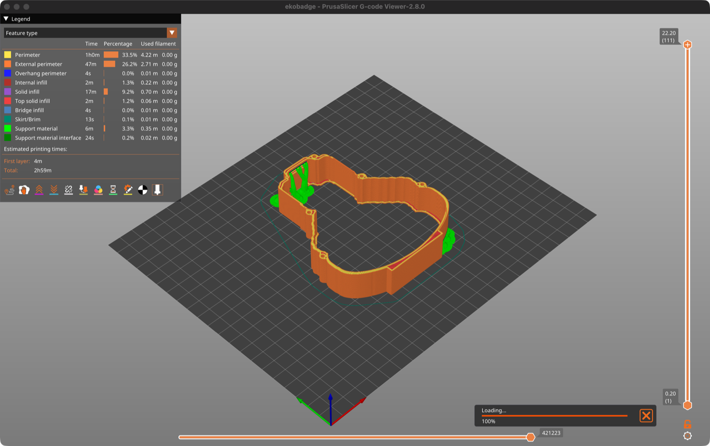
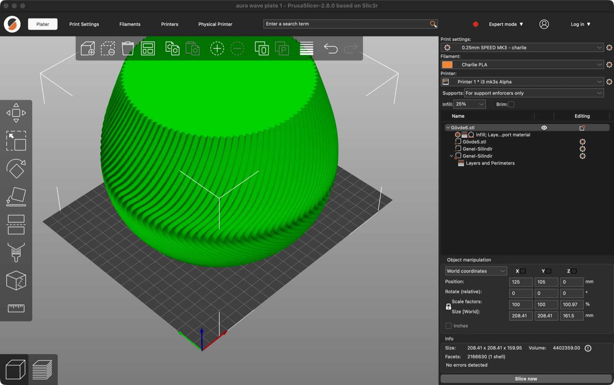

<h1 align="center">bambu2prusa</h1>

<p align="center">
  Open Bambu Studio 3MF projects in PrusaSlicer — one file per plate, negative parts included.
</p>

<p align="center">
  
</p>

> [!WARNING]
> **Lightly tested.** So far this has been tried on two real projects (below) with
> PrusaSlicer 2.8.0 on macOS. It covers what those files use; other Bambu features
> may not convert, or may convert wrong. Check the result in PrusaSlicer before
> printing, and please open an issue with the 3MF if something breaks.

## The problem

PrusaSlicer 2.8 refuses many 3MF files saved by Bambu Studio:

```
Error (Invalid 3MF format) while parsing '3D/3dmodel.model'
Found component with invalid object id
```

Bambu Studio keeps each mesh in its own file under `3D/Objects/` and points to
it from the main model with 3MF production-extension components (`p:path`).
PrusaSlicer does not follow those references. Bambu's own "export STL" works
around it, but it flattens everything: negative parts are lost, modifiers are
lost, and every plate ends up in one mesh.

## What it does

`bambu2prusa.py` reads the Bambu project and writes a PrusaSlicer 3MF for each
plate:

- **Every part keeps its role.** Model parts, negative parts, modifiers and
  support blockers/enforcers become the matching PrusaSlicer volumes, still
  editable in the object list.
- **Transforms are baked in**, including mirrored parts (their triangles are
  flipped so normals still point out).
- **One file per plate**, named after the plate, with the parts centred on the bed.
  PrusaSlicer 2.8 has no plates.
- **Design settings come along** as per-object overrides when PrusaSlicer has an
  equivalent: walls → perimeters, top/bottom shell layers, infill density and
  pattern, surface patterns, ironing on/off, supports (Bambu "tree" → "organic").
  Settings on individual parts and modifiers carry over too.
- **Printer and material settings don't.** Layer height, speeds and temperatures
  come from your PrusaSlicer profile. If the original used spiral vase, the
  script says so, because spiral vase is a print-wide setting in PrusaSlicer.

It is a single Python 3 file with no dependencies.

## Usage

```bash
python3 bambu2prusa.py "My project.3mf"
```

That creates `My project (PrusaSlicer)/` next to the input, with one `.3mf` per
plate, and prints each part's size:

```
1 - Sin base sin agujero de antena.3mf: 98.2 x 115.5 x 22.1 mm
...
6 - Protector frente.3mf: 30.0 x 31.0 x 7.0 mm
Done: /Users/me/Downloads/Carcasa EKOBADGE (PrusaSlicer)
```

Options:

| Option | Default | What it does |
|---|---|---|
| `output` (2nd argument) | `<input> (PrusaSlicer)` | Output folder |
| `--bed WxD` | `250x210` (MK3/MK4) | Bed size used to centre the parts and to warn when something doesn't fit |
| `--scale S` | `1` | Uniform scale, as a factor (`0.85`) or a percentage (`85%`) |

`--scale` scales **everything**, holes included: a 40.5 mm lamp-holder hole
becomes 34.4 mm at 85 %. If a hole has to keep its size, scale in PrusaSlicer
and resize that negative volume on its own.

## Tested with

**A badge case with six plates** (four variants of the frame, a back cover and a
front protector). Each frame has 7 model parts and up to 11 negative parts, two
of them mirrored. All six plates load and slice in PrusaSlicer 2.8. I checked
the result against Bambu Studio by slicing the original from its command line
and comparing the two G-codes from above: same outline, same open frame, same
screw bosses. With the negative parts turned into solids, the frame would need
124 m of filament instead of 8 m, so they really cut.

<p align="center">
  
</p>

**A spiral lamp shade** ("Aura Wave", from Lamp Shade 4.0 by JANBERRY): 2.1
million triangles, with a negative cylinder for the lamp-holder hole and a
cylinder modifier that sets 0 bottom layers. Converted at `--scale 85%` so it
fits a 250 × 210 bed (208 mm across).

<p align="center">
  
</p>

The model files are not included here; they belong to their authors.

## Known limits

- **Size [World] looks off.** In PrusaSlicer, "Size [World]" and "Scale factors"
  count the negative parts when they stick out of the model (the lamp's hole
  cylinder goes 1.5 mm below the bed). The **Info** box shows the real size of
  the part.
- **No paint data.** Painted supports, seams and colour (MMU) painting are not
  converted.
- **One instance per object.** Several copies of an object on a Bambu plate
  are not reproduced.
- **Single filament.** Filament assignments are dropped, so multi-colour
  projects come out in one colour.
- **No plate settings.** Settings saved on the plate itself in Bambu (per-plate
  layer height, print sequence) are ignored.
- **Text and SVG parts become plain meshes.** Bambu's editable text and SVG
  parts can't be edited as text in PrusaSlicer.
- **Only PrusaSlicer 2.8.0 tested.** Older and newer versions should read the
  same format, but they haven't been tried.

## En castellano

Un script de Python que convierte los 3MF de Bambu Studio que PrusaSlicer 2.8 no
abre ("Found component with invalid object id"). Escribe un 3MF por placa y
conserva las partes negativas, los modificadores y los ajustes de diseño
(paredes, capas, relleno, soportes).

```bash
python3 bambu2prusa.py "Mi proyecto.3mf" --scale 85%
```

**Está poco probado:** funcionó con dos proyectos reales (una carcasa de seis
placas y una pantalla de lámpara). Revisá el resultado en PrusaSlicer antes de
imprimir, y si algo falla, abrí un issue con el 3MF.

## License

[MIT](LICENSE)
